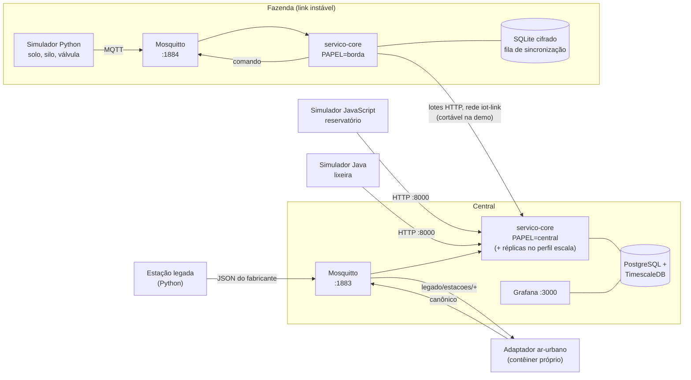

# Arquitetura

Como a Plataforma IoT Integrada foi construída, em relação à arquitetura de referência do Documento de Requisitos v2.0 (seção 3). As decisões estão nos [ADRs](adr/README.md) e o status de cada requisito, em [rastreabilidade.md](rastreabilidade.md).

## Princípios

1. **Integração por contrato, não por biblioteca** ([ADR-0002](adr/0002-integracao-por-contratos-abertos.md)). Tudo o que entra e sai está descrito em JSON Schema, AsyncAPI 3 e OpenAPI 3, na pasta [`contratos/`](../contratos). Os simuladores em Python, JavaScript e Java e o adaptador urbano usam só MQTT ou HTTP e o contrato.
2. **Neutralidade de cenário** ([ADR-0003](adr/0003-catalogo-configuravel.md), RNF-08). O núcleo não conhece "talhão", "silo" ou "praça": domínios, perfis, locais, áreas e regras são dados (padrão Type Object). O domínio `recursos_hidricos` nasce ao vivo pela API, sem tocar no código.
3. **Operação desconectada.** O nó de borda guarda tudo numa fila persistente, decide localmente e sincroniza em lotes. A central deduplica pelo `id_mensagem`, armazena pelo horário da medição e aceita dados atrasados sem disparar regras com eles.

## Camadas do documento e o que as implementa

| Camada (seção 3.2) | Implementação |
|---|---|
| 1 · Dispositivos e borda | Simuladores em contêineres ([`simuladores/`](../simuladores)); nó de borda = `servico-core` com `PAPEL=borda`, SQLite cifrado e Mosquitto local ([`infra/borda`](../infra/borda)) |
| 2 · Conectividade e ingestão | Mosquitto; consumidor MQTT e `POST /api/v1/ingestao` e `/ingestao/lote` no `servico-core`; pipeline de ingestão; adaptador plugável [`ar-urbano`](../adaptadores-plugaveis/ar-urbano) (nível 2) |
| 3 · Gestão de dispositivos | Catálogo e cadastro (domínios, perfis, sites, áreas, dispositivos), token por dispositivo com revogação, estado online/offline/desconhecido |
| 4 · Processamento e regras | Enriquecimento e normalização de unidades no pipeline; motor de regras (limite, janela, ausência) com cinco ações; ciclo de vida dos alarmes |
| 5 · Dados | PostgreSQL + TimescaleDB na central (séries em hypertable, último estado, catálogo, regras, alarmes, DLQ); SQLite cifrado na borda |
| 6 · Aplicação e serviços | API REST versionada (`/api/v1`), Swagger UI gerado do contrato, webhooks e publicação em tópico pelas regras, painel do Grafana provisionado |
| Transversais | Chave de API com papéis e `X-Inquilino`; token por dispositivo; `/metrics` Prometheus; logs JSON com `correlation_id` |

As substituições em relação às tecnologias sugeridas pelo documento estão no [ADR-0007](adr/0007-infraestrutura-aberta.md):

- o último estado fica numa tabela do PostgreSQL, sem Redis ([ADR-0017](adr/0017-ultimo-estado-no-postgresql.md));
- a autenticação usa chaves e tokens, sem Keycloak ([ADR-0018](adr/0018-autenticacao-sem-keycloak.md));
- não há servidor Prometheus;
- não há PostGIS.

## Implantação: central e borda



**Uma imagem, dois ambientes.** O `servico-core` gera uma única imagem Docker ([ADR-0006](adr/0006-uma-imagem-dois-ambientes.md)). A raiz de composição ([`principal.py`](../servico-core/principal.py)) lê `PAPEL` e liga cada porta ao adaptador do ambiente:

- **Na central:** PostgreSQL e as ações de regra comuns.
- **Na borda:**
  - SQLite cifrado, com os mesmos repositórios SQL ([ADR-0020](adr/0020-repositorios-sql-na-borda.md));
  - a fila de sincronização e o sincronizador;
  - ações que, além de agir, avisam a central.

**Redes.**

- Cada ambiente tem sua rede Compose.
- A borda alcança a central pela rede externa `iot-link`, onde a central atende pelo nome `central`. Cortar o link na demonstração é desconectar o contêiner da borda dessa rede.
- Os simuladores e o adaptador alcançam as portas publicadas pelo `host.docker.internal`, como um cliente externo.

**Portas:** a central publica API 8000, MQTT 1883, banco 5432 e Grafana 3000; a borda publica API 8001 e MQTT 1884 ([infra/README.md](../infra/README.md)).

## O `servico-core`: arquitetura hexagonal

```
servico-core/
├── dominio/       # regras do negócio; não importa FastAPI, paho, psycopg nem sqlite
├── portas/        # Protocols que o domínio usa
├── adaptadores/   # implementações: rest, mqtt, postgres, sqlite, memoria, acoes, central, ...
├── principal.py   # raiz de composição: escolhe os adaptadores pela configuração
└── configuracao.py
```

**Domínio** ([`dominio/`](../servico-core/dominio)):

- pipeline de ingestão;
- catálogo;
- consultas;
- motor de regras e ações;
- alarmes;
- sincronização da borda;
- permissões por papel;
- paginação;
- conversão de unidades.

**Portas** ([`portas/`](../servico-core/portas)):

| Grupo | Portas |
|---|---|
| Catálogo e dados | `Catalogo`, `RepositorioDeCatalogo`, `RepositorioDeIngestao`, `RepositorioDeConsultas`, `FilaDeRejeitadas` |
| Regras e alarmes | `RepositorioDeRegras`, `RepositorioDeAlarmes` |
| Saídas das ações | `Notificador`, `Publicador`, `ClienteWebhook` |
| Borda | `FilaDeSincronizacao`, `ClienteDaCentral` |
| Infraestrutura | `Autenticador`, `ValidadorDeContrato`, `GeradorDeCredenciais`, `Relogio` |

**Adaptadores** ([`adaptadores/`](../servico-core/adaptadores)):

| Adaptador | Para quê |
|---|---|
| `rest/` | FastAPI; corpos validados pelos schemas do OpenAPI; erros no formato `Erro` do contrato |
| `mqtt.py` | Consumidor com sessão persistente e confirmação só depois de gravar; publicador de comandos |
| `postgres/` | Repositórios SQL e migrações |
| `sqlite/` | Pool e dialeto que deixam os repositórios SQL rodarem no SQLite cifrado; fila de sincronização |
| `memoria.py` | Implementações em memória, para os testes e para subir sem banco |
| `central.py` | Cliente HTTP da borda para a central |
| `acoes.py` | Notificador em log, webhook HTTP, publicador em log |
| `observabilidade.py` | Logs JSON e métricas Prometheus |

A independência do domínio é verificável: os testes de domínio rodam com os adaptadores em memória, e os mesmos testes de repositório rodam contra o PostgreSQL e o SQLite.

## Contratos

| Contrato | Arquivo | Uso em tempo de execução |
|---|---|---|
| Mensagem canônica 1.0 e lote 1.0 | [`json-schema/`](../contratos/json-schema) | Cada mensagem é validada contra o schema da sua versão; a recusada vai para a DLQ com os erros |
| Tópicos MQTT | [`asyncapi.yaml`](../contratos/asyncapi.yaml) | `{inquilino}/{site}/{dominio}/{dispositivo}/{telemetria\|evento\|estado\|comando}`; o tópico precisa corresponder à mensagem e ao cadastro |
| API REST | [`openapi.yaml`](../contratos/openapi.yaml) | Swagger UI gerado do arquivo; corpos validados pelos schemas; um teste confere nos dois sentidos que rotas e operações coincidem |

**Validação no CI:** o CI valida os três contratos, os exemplos e as amostras dos simuladores das três linguagens. Os contratos são servidos em `/contratos` (RF-INT-01).

## Pipeline de ingestão

Pipes and Filters ([ADR-0008](adr/0008-pipeline-de-ingestao.md)), igual para MQTT, HTTP, lote e borda:

```
validar → autorizar → deduplicar → enriquecer → persistir → observadores (motor de regras)
   │          │           │             │
   └──────────┴───────────┴─────────────┴──→ DLQ (rejeitadas: etapa, motivo, erros, carga)
```

1. **Validar:** JSON válido, versão suportada e schema da versão.
2. **Autorizar:**
   - a credencial pertence a um inquilino;
   - o papel pode enviar;
   - o dispositivo da credencial e o tipo do tópico correspondem à mensagem.
3. **Deduplicar** pelo `id_mensagem` (Idempotent Receiver). A gravação do id e dos dados é atômica, então reenvios simultâneos também resultam numa só cópia. A janela é de 7 dias ([ADR-0011](adr/0011-janela-de-deduplicacao.md)).
4. **Enriquecer:**
   - busca o dispositivo, o perfil, o domínio, o local e a área;
   - confere o site e o domínio do tópico;
   - recusa medições posteriores à revogação da credencial;
   - converte unidades para as do perfil;
   - marca como suspeita a medida fora da faixa;
   - carimba a hora de recepção quando o dispositivo não manda `timestamp` ([ADR-0009](adr/0009-relogio-da-borda.md)).
5. **Persistir:** grava medições, eventos, último estado e último contato na mesma transação.
   - O último estado e o último contato só avançam com medição mais nova, então o dado atrasado entra no histórico sem sobrescrever o presente.
   - Na borda, a mesma transação põe a mensagem na fila de sincronização (outbox).
6. **Observadores:** o motor de regras recebe a mensagem gravada. Uma falha nele não desfaz a ingestão.

A mensagem é "atual" quando chega até 5 minutos depois da medição (`LIMITE_DADO_ATUAL_S`). Só dados atuais disparam regras (RF-ING-04, [ADR-0013](adr/0013-dados-atrasados-e-agregados.md)).

## Regras e alarmes

- **Condições:**
  - `limite`: valor contra um limiar;
  - `janela`: condição contínua por um período, contado pelo horário da medição;
  - `ausencia`: sem dados por um período, com verificação periódica.

  Filtros por domínio, site, área ou dispositivo. A área é um identificador, sem geometria (inconsistência 2 da rastreabilidade).
- **Disparo na transição.** O estado de cada par regra–dispositivo fica no banco. A regra dispara quando a condição passa a valer e se rearma, resolvendo o alarme aberto, quando ela deixa de valer.
- **Ações no padrão Strategy** ([`dominio/acoes.py`](../servico-core/dominio/acoes.py)):
  - alarme;
  - notificar (no MVP, registrado no log; o SMS fica na central, [ADR-0012](adr/0012-sms-pela-central.md));
  - comando canônico no tópico do atuador;
  - webhook;
  - publicação num tópico do próprio inquilino.

  Uma ação nova é uma classe nova. A falha de uma ação não impede as outras.
- **Alarmes:** ciclo ativo → reconhecido → resolvido, com severidade. Cada nó abre e resolve os alarmes que gera (`origem` central ou borda), um aberto por regra, dispositivo e origem.
- **Borda:** a borda roda o mesmo motor, só com as regras de `ambito: borda`. Sem link, o alarme é aberto localmente e o comando vai à válvula pelo broker local. Três eventos canônicos entram na fila com prioridade:
  - `alarme`;
  - `comando_enviado`;
  - `alarme_resolvido`.

  A central os aplica com os horários da borda (RF-PRO-05).

## Borda e sincronização

- **Fila (outbox).** A tabela `fila_sincronizacao` é escrita na mesma transação da ingestão: se a gravação falha, nada entra na fila, e vice-versa (RNF-10).
- **Sincronizador** ([`dominio/sincronizacao.py`](../servico-core/dominio/sincronizacao.py)):
  - a cada 5 s, envia lotes de até 500 mensagens a `POST /api/v1/ingestao/lote`, eventos primeiro;
  - remove cada item só depois que a central responde por ele: aceita, duplicada ou recusada (a recusada fica na DLQ da central, com o motivo);
  - se a resposta se perde, reenvia, e a deduplicação da central absorve a cópia.
- **Cifragem:** SQLCipher, com a chave derivada de um segredo Docker ([ADR-0014](adr/0014-chave-da-fila-da-borda.md)). Com WAL e escrita transacional, a fila sobrevive a quedas de energia ([ADR-0016](adr/0016-energia-e-armazenamento-da-borda.md)).
- **Estado "desconhecido":** com a borda sem sincronizar, os sensores dela aparecem como "desconhecido", e não como offline ([ADR-0010](adr/0010-estado-desconhecido.md)).
- **Prova das 72 h:** o teste automatizado [`testes-sistema/desconexao`](../testes-sistema/desconexao) injeta 72 h de leituras retroativas, reinicia a borda no meio do corte e perde a resposta do primeiro lote. No fim, confere que cada medição chegou uma vez, na hora da medição.

## Dados

| Tabela | Conteúdo |
|---|---|
| `inquilinos`, `chaves_api`, `dominios`, `perfis`, `sites`, `areas`, `dispositivos` | Catálogo, sempre com `inquilino_id`. Os perfis guardam as grandezas, as unidades, a faixa válida e o intervalo esperado. Os dispositivos guardam só o hash do token |
| `medicoes` (hypertable) | Uma linha por medida, pelo horário da medição, com `recebido_em` e `persistido_em` para medir latência |
| `eventos` (hypertable) | Eventos e estados relatados |
| `ultimo_estado`, `ultimo_contato`, `contato_da_borda` | Último valor por grandeza, último contato por dispositivo, último contato de cada borda |
| `mensagens_recebidas` | `id_mensagem` já aceitos, para a deduplicação |
| `rejeitadas` | DLQ: etapa, motivo, erros e carga original |
| `regras`, `estado_regras`, `alarmes` | Regras como JSON, estado da transição por regra e dispositivo, alarmes com origem |
| `fila_sincronizacao` (só na borda) | Mensagens aceitas e ainda não confirmadas pela central |

As migrações são SQL puro, aplicadas na inicialização, com uma pasta por ambiente. Na central, uma trava consultiva impede que várias réplicas apliquem a mesma migração ao mesmo tempo. Os agregados por hora e por dia (continuous aggregates, RF-PRO-04, Importante) não foram implementados: o painel do Grafana agrega as medições brutas com `time_bucket`.

## Segurança

| Requisito | No MVP | Evolução |
|---|---|---|
| RF-SEG-01 (OIDC + MFA) | Só documentado | Keycloak com TOTP |
| RF-SEG-02 (papéis) | Chave de API com papel em tabela: administrador, gestor, operador, integrador, leitor e no_borda | Papéis vindos do provedor de identidade |
| RF-SEG-03 (isolamento) | Toda consulta e gravação filtra pelo inquilino da credencial | Row-level security como segunda barreira |
| RF-SEG-04 (tópicos) | O núcleo recusa mensagem publicada no tópico de outro dispositivo | ACL por dispositivo no Mosquitto |
| RF-SEG-05 (borda) | Chave própria do nó (`no_borda`) e fila cifrada | Chave em TPM ou cofre externo |
| RNF-11 (TLS) | Portas sem TLS, publicadas só em 127.0.0.1 por padrão | TLS nos brokers e nas APIs |

## Observabilidade

- **Métricas (`/metrics`, formato Prometheus):**
  - mensagens por entrada, situação e motivo;
  - histograma do tempo de ingestão;
  - fila pendente da borda.
- **Logs JSON:** cada linha tem `correlation_id` igual ao `id_mensagem`, e a mesma mensagem leva o mesmo id e o campo `via` da borda até a central.
- **Grafana:** o painel provisionado mostra medições, último estado, alarmes, DLQ, bordas sem sincronizar, vazão e latência p95 da ingestão até a persistência.

## Escala e desempenho

O teste de carga ([`testes-sistema/carga`](../testes-sistema/carga/README.md), [ADR-0022](adr/0022-escala-da-ingestao-com-assinatura-compartilhada.md)) comprovou 1.000 msg/s por MQTT no notebook da apresentação, sem perdas nem duplicatas:

- p95 de 0,09 s a 0,53 s até a persistência;
- p95 de 0,40 s a 0,60 s até o disparo da regra;
- 10 processos do `servico-core` num grupo de assinatura compartilhada, falando com o PostgreSQL pelo socket Unix.

O teto da máquina vai de 1.020 a 1.050 msg/s, conforme o que mais roda no notebook, então a folga é pequena.

O que a medição mostrou:

- **Um processo Python sustenta cerca de 100 a 150 msg/s**, limitado pela CPU e pelas idas e voltas ao banco. O banco tinha folga.
- **O socket Unix rende 13% a 15% mais que TCP**, porque metade da CPU ia para a pilha de rede.
- **A escala é horizontal (RNF-09).** Os processos não guardam estado; as réplicas usam sessão MQTT limpa e só o processo principal verifica ausências.
- **As 10.000 msg/s ficam documentadas:** o próximo passo é gravar em micro-lotes, com uma transação para dezenas de mensagens.

## Padrões de projeto aplicados (seção 7.2)

| Padrão | Onde está |
|---|---|
| Portas e adaptadores (hexagonal) | `dominio/`, `portas/`, `adaptadores/`, `principal.py` |
| Type Object | Domínios, perfis e regras como dados (`dominio/catalogo.py`, `dominio/regras.py`) |
| Modelo canônico (EIP) | `contratos/json-schema/mensagem-canonica-1.0.json` |
| Adapter (nível 2) | `adaptadores-plugaveis/ar-urbano/traducao.py` |
| Pipes and Filters | `dominio/pipeline.py` |
| Dead Letter Channel | Tabela `rejeitadas`, `GET /api/v1/rejeitadas` |
| Idempotent Receiver | `mensagens_recebidas` e `INSERT ... ON CONFLICT DO NOTHING` na mesma transação dos dados |
| Store-and-forward / entrega garantida | `fila_sincronizacao` (outbox) e `dominio/sincronizacao.py` |
| Publicação/assinatura | Tópicos MQTT; assinatura compartilhada entre réplicas |
| Strategy | `dominio/acoes.py` |
| Observer | Observadores do pipeline (`ObservadorDeIngestao`), motor de regras |
| Repository | `portas/repositorios.py` com implementações PostgreSQL, SQLite e memória |
| Retry | Sincronização da borda: reenvio do lote até a confirmação |
| Plugin | Adaptadores e simuladores em contêineres próprios |

Fora do MVP:

- gêmeo do dispositivo (Device Shadow), com comandos para aparelhos offline;
- CQRS com bancos separados;
- API Gateway;
- Circuit Breaker. Hoje um webhook com falha não derruba a ingestão, mas não há corte automático.

## Desvios e evolução prevista

| Hoje | Evolução |
|---|---|
| Último estado em tabela do PostgreSQL | Redis, se a leitura do último estado virar gargalo |
| Chave de API e token por dispositivo | Keycloak (OIDC, MFA) e certificados X.509 |
| `/metrics` sem servidor Prometheus | Prometheus e alertas |
| Área como identificador | PostGIS e consultas espaciais (RF-CEN-04) |
| Regras locais cadastradas na API da borda | Distribuição de regras pela central (RF-EDG-04) |
| Gravação de uma mensagem por transação | Micro-lotes, para chegar a 10.000 msg/s |
| Imagem só x86 | Imagem multi-arquitetura para ARM (Raspberry Pi, RNF-06) |
| Notificação em log (inclusive "SMS") | Provedor de SMS na central (RF-APP-05) |
